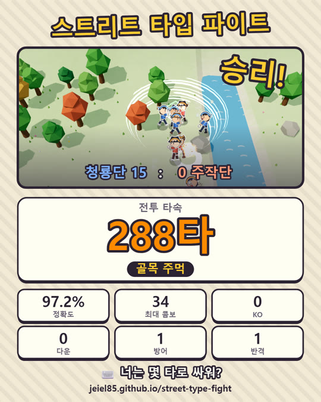

<div align="center">

# ⌨️👊 스트리트 타입 파이트

**자판으로 치고받는 2.5D 동네 대난투**
한 타 한 타가 주먹이 되고, 스킬도 방어도 타자로 하는 실시간 타자 격투 게임

[](https://github.com/jeiel85/street-type-fight/actions/workflows/pages.yml)
[](LICENSE)


## [▶ 브라우저에서 바로 플레이](https://jeiel85.github.io/street-type-fight/)

설치·가입 없음 · **PC + 물리 키보드**로 플레이


<sub>🇺🇸 A real-time Korean typing brawler in a small quarter-view world. Every correct keystroke is a punch, skills are cast by typing their names, and incoming attacks are blocked by typing a defense word before impact. Korean 2-set (두벌식) input is decoded from physical keys, so it works regardless of the OS IME state. All art and sound are generated in code.</sub>

</div>

---

## 🥊 어떻게 싸우나요

| | |
|---|---|
| **공격** | 상대 머리 위 단어를 친다. 맞게 친 자모 하나가 잽 한 방, 마지막 글자가 마무리 강타 |
| **스킬** | `장풍` · `돌려차기` · `철벽` · `회오리바람` 을 치면 발동. 길수록 강하다 |
| **방어** | 공격이 날아오면 빨간 방어 단어가 뜬다. 맞기 전에 치면 막고, **빨리 치면 반격** |
| **필살기** | 기세가 가득 차면 `고래 싸움에 새우 등 터진다` 같은 속담 한 줄로 벼락 |
| **오타** | 헛손질하면 콤보가 끊긴다. 빠르게, 그리고 정확하게 |

청룡단 대 주작단 4:4, 먼저 15킬을 따내는 팀이 이깁니다. 마을은 안전지대, 개울 다리는 격전지예요. 청룡 마을 옆 수련장에서는 허수아비로 연습할 수 있습니다.

## 📸 점수 카드로 자랑하기



판이 끝나면 결과 화면에서 **점수 카드**를 저장·복사·공유할 수 있어요.

- 마지막 장면, 승패, **전투 타속**과 칭호, 정확도·콤보·KO·반격
- SNS 피드에서 잘리지 않는 4:5 비율(1080×1350)
- 칭호: 동네 새내기 → 골목 주먹 → 장터 싸움꾼 → 마을 대장 → 고을 영웅 → 전설의 타자왕

**전투 타속**은 실제로 치고 있던 구간만 센 타/분입니다. 1.5초 넘게 쉰 시간은 빼요.

<br clear="right">

## 🎮 조작

| 키 | 동작 |
|---|---|
| 글자키 | 타자 — 한/영 상태와 상관없이 **두벌식 자판 위치**로 입력 |
| ← ↑ ↓ → | 이동 (공격 단어를 치는 동안엔 대상에게 자동으로 밀고 들어감) |
| Tab | 다음 대상 |
| 1 · 2 · 3 | 대상 전략 — 가까운 적 / 나를 노리는 적 / 빈사 상태 적 |
| Backspace | 치던 단어 취소 |
| Esc | 메뉴 |

## 💻 요구 사항 · 개인정보

- PC와 물리 키보드, WebGL을 쓸 수 있는 최신 Chrome · Edge · Firefox
- 휴대폰으로 열면 PC로 링크를 보내는 안내 화면이 나옵니다
- 로그인·분석 도구·서버 통신이 없습니다. 기록은 저장하지 않고, 점수 카드는 직접 저장·공유할 때만 기기 밖으로 나갑니다

## 🛠 개발

```bash
npm install
```

```bash
npm run dev
```

| 명령 | 하는 일 |
|---|---|
| `npm run dev` | 개발 서버 |
| `npm test` | 단위 테스트 — 두벌식 조합, 판정기, 전투 규칙, 점수 카드, 봇 4:4 난투 스모크 |
| `npm run build` | 타입 검사 + 배포 빌드(`dist/`) |

`main`에 머지되면 GitHub Actions가 테스트·빌드 후 GitHub Pages로 배포합니다.

```text
src/
  config.ts     밸런스 수치(단일 출처)
  typing/       두벌식 키 매핑 · 한글 분해/조합 · 첫 키 잠금 판정기 · 단어·속담 사전
  sim/          전투 시뮬레이션(렌더링과 분리, 서버로 옮길 수 있음) · 봇 · 월드 배치
  render/       Three.js 장면 · 지형 · 소품 · 종이인형 캐릭터 · 이펙트
  ui/           HUD 타자 덱 · 월드 라벨 · 미니맵 · 점수 카드
  audio/        Web Audio 합성 효과음
```

**2.5D를 외부 애셋 없이:** 3D 로우폴리 맵 위에 2D 종이인형 캐릭터를 세웠어요. 캐릭터는 캔버스에 직접 그린 부위를 관절로 움직이고, 기와집·장승·이펙트·효과음까지 모두 코드로 만듭니다.

## 🗺 로드맵

- [x] 싱글 플레이 전투 프로토타입, 점수 카드 공유
- [ ] 친구와 방 코드로 붙는 온라인 대전
- [ ] 홈 위치에서 손을 떼지 않는 이동(Ctrl + ESDF)
- [ ] 직업 추가(술사·도사·자객), 영문 모드

자세한 설계는 [게임 디자인 문서](docs/GDD.md), 결정 기록은 [DECISIONS.md](DECISIONS.md), 할 일은 [BACKLOG.md](BACKLOG.md), 변경 내역은 [CHANGELOG.md](CHANGELOG.md)에 있습니다.

## 📄 라이선스

[MIT](LICENSE) — 코드, 그림(캔버스 생성), 효과음(Web Audio 합성) 모두 이 저장소에서 만들어집니다. 런타임 의존성은 [three.js](https://threejs.org)(MIT)뿐입니다.
