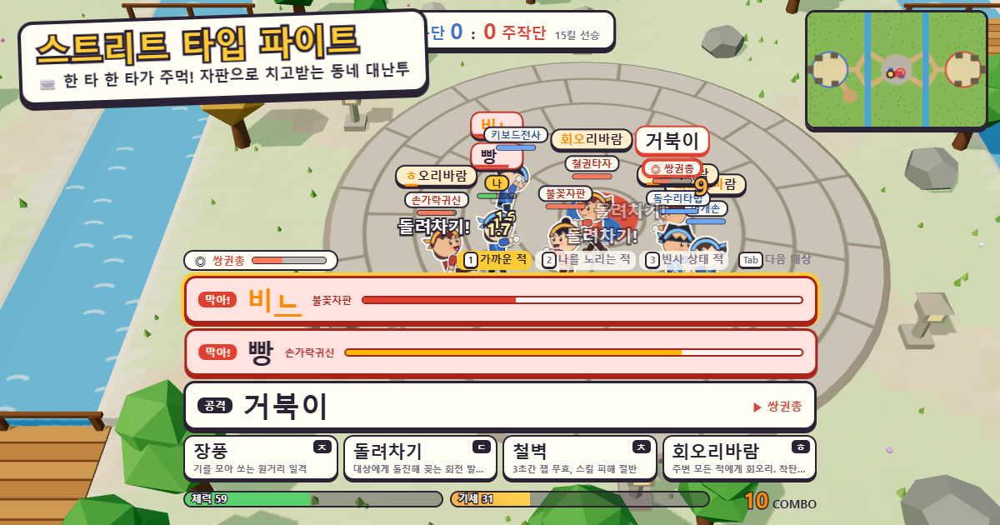

<div align="center">

# ⌨️👊 스트리트 타입 파이트

**자판으로 치고받는 2.5D 동네 대난투**

[](https://jeiel85.github.io/street-type-fight/)


### [▶ 브라우저에서 바로 플레이](https://jeiel85.github.io/street-type-fight/)

설치도 가입도 필요 없어요. **PC + 물리 키보드**로 플레이합니다.



<sub>🇺🇸 A real-time typing brawler in a small quarter-view open world. Every correct keystroke is a punch, skills are cast by typing their names, and incoming attacks are blocked by typing a defense word before impact. Korean 2-set (두벌식) input is decoded from physical keys, so it works regardless of the OS IME state. All art and sound are generated in code.</sub>

</div>

---

## 어떤 게임인가요

- **키 한 번 = 주먹 한 방** — 상대 머리 위 단어를 치면 맞게 친 자모마다 잽이 나가고, 마지막 글자에 마무리 강타가 들어갑니다.
- **스킬은 주문처럼** — `장풍` · `돌려차기` · `철벽` · `회오리바람`을 치면 발동합니다.
- **방어도 타자로** — 날아오는 공격에 붙은 빨간 방어 단어를 맞기 전에 치면 막고, 빨리 치면 **반격**합니다.
- **필살기는 속담 한 줄** — 기세가 차면 `고래 싸움에 새우 등 터진다` 같은 속담을 쳐서 벼락을 내립니다.
- **길에서 붙는 오픈월드** — 던전 없이 필드에서 바로 싸우고, 마을만 안전지대입니다(바람의 나라식).
- **외부 애셋 0** — 종이인형 캐릭터, 기와집, 장승, 이펙트, 효과음까지 모두 코드로 그리고 합성합니다.

자세한 설계는 [게임 디자인 문서(GDD)](docs/GDD.md)에 있습니다.

## 요구 사항

- PC와 물리 키보드(두벌식 자판 위치 기준. 한/영 상태는 상관없음)
- WebGL을 쓸 수 있는 최신 Chrome · Edge · Firefox
- 휴대폰으로 열면 PC로 링크를 보내는 안내 화면이 나옵니다

## 개인정보

로그인·분석 도구·서버 통신이 없습니다. 입력과 기록은 브라우저 밖으로 나가지 않고, 저장도 하지 않습니다.

## 직접 실행

```bash
npm install
```

```bash
npm run dev
```

브라우저에서 `http://localhost:5173`(포트는 터미널에 표시)을 열고 **Enter**로 시작합니다. 물리 키보드가 필요합니다.

| 명령 | 하는 일 |
|---|---|
| `npm run dev` | 개발 서버 |
| `npm test` | 단위 테스트(두벌식 조합, 판정기, 전투 규칙, 봇 난투 스모크) |
| `npm run typecheck` | 타입 검사 |
| `npm run build` | 타입 검사 + 배포 빌드(`dist/`) |

## 조작

| 키 | 동작 |
|---|---|
| 글자키 | 타자(한/영 상태와 무관하게 두벌식 자판 위치로 입력) |
| ←↑↓→ | 이동 |
| Tab | 다음 대상 |
| 1 · 2 · 3 | 대상 전략: 가까운 적 / 나를 노리는 적 / 빈사 상태 적 |
| Backspace | 지금 치던 단어 취소 |
| Esc | 메뉴 |

## 구조

```text
src/
  config.ts          밸런스 수치(단일 출처)
  typing/            두벌식 키 매핑 · 한글 분해/조합 · 후보 판정기 · 단어 사전
  sim/               전투 시뮬레이션(렌더링과 분리, 서버로 옮길 수 있음) · 봇 · 월드 배치
  render/            Three.js 장면 · 지형 · 소품 · 종이인형 캐릭터 · 이펙트
  ui/                HUD 타자 덱 · 월드 라벨 · 미니맵
  audio/             Web Audio 합성 효과음
tests/unit/          Vitest 단위 테스트
docs/GDD.md          게임 디자인 문서
```

설계 결정은 [DECISIONS.md](DECISIONS.md), 다음 할 일은 [BACKLOG.md](BACKLOG.md)를 보세요.

## 현재 범위와 알려진 제한

- 싱글 플레이 전투 프로토타입입니다(나 + 봇 3 대 봇 4, 15킬 선승). **온라인 대전은 아직 없습니다.** "타자 난투가 재미있는가"를 이 데모로 확인한 뒤에 진행합니다([GDD §12](docs/GDD.md#12-이번-프로토타입이-답해야-할-질문과-성공-기준)).
- 세벌식 자판, 영문 모드, 휴대폰은 지원하지 않습니다.
- 변경 내역은 [CHANGELOG.md](CHANGELOG.md)에 있습니다.

## 라이선스

[MIT](LICENSE) — 코드, 그림(캔버스 생성), 효과음(Web Audio 합성) 모두 이 저장소에서 만들어집니다. 런타임 의존성은 [three.js](https://threejs.org)(MIT)뿐입니다.
